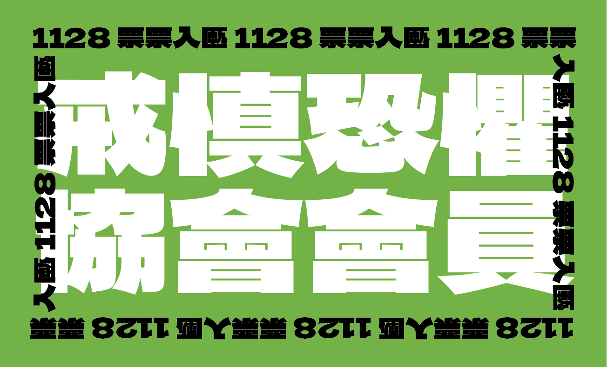
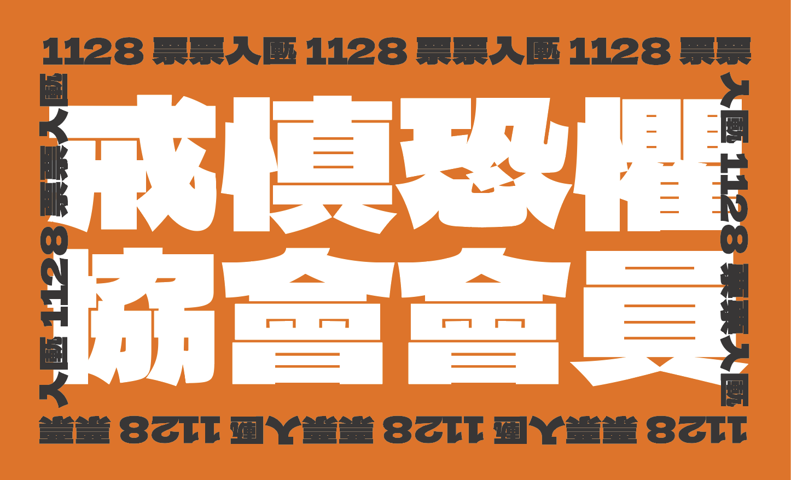
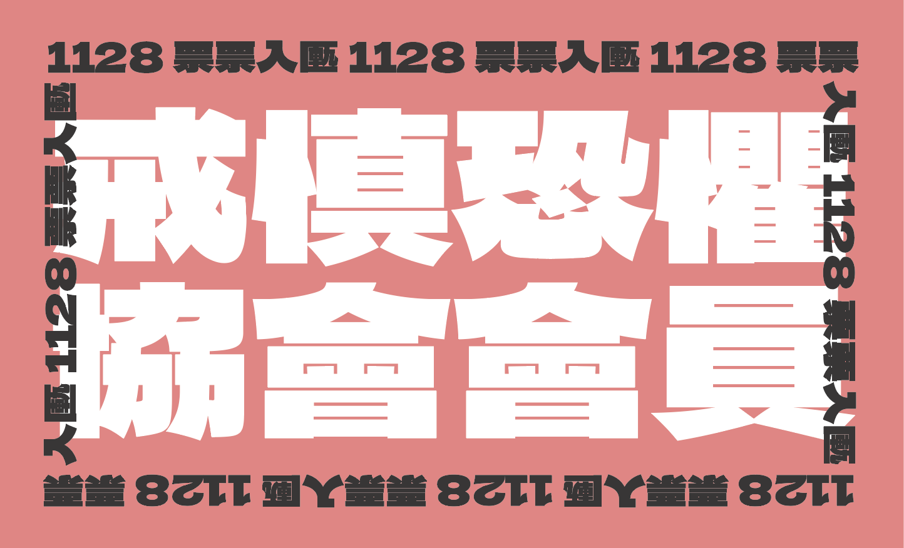
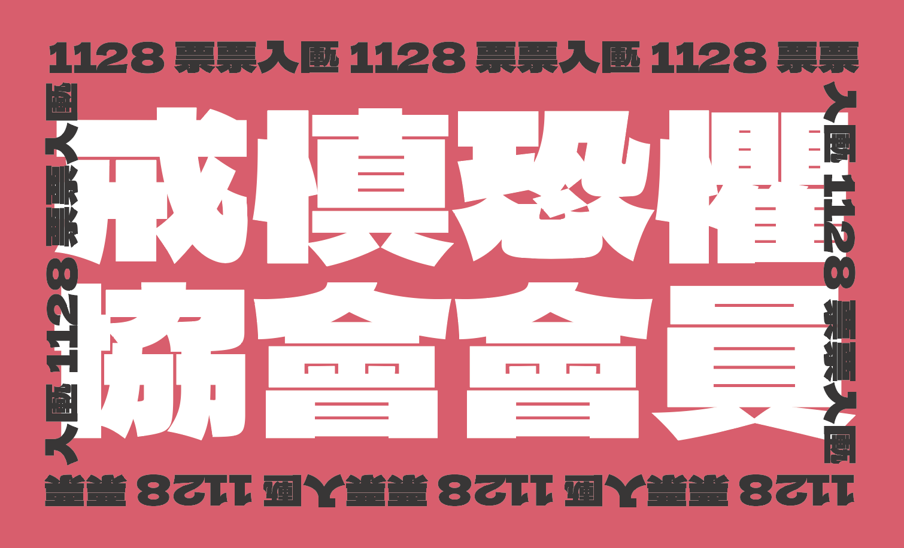

# TAIPEI_SOON

開放原始檔供大家自行下載、印製與自用。

## 第一批釋出：戒慎恐懼協會

- 配色：綠、橘、粉、深粉（四款）
- 檔案：[戒慎恐懼協會.zip](送印物/戒慎恐懼協會.zip)（內含四款 `.ai` 原始檔）
- 規格：藍格影印刀模版本
- 送印：於「藍格」網站選取「彩色名片型貼紙」送印即可。 網址為 https://ec.blueco.com.tw/

### 預覽

| 配色 | 預覽圖 |
|---|---|
| 綠 |  |
| 橘 |  |
| 粉 |  |
| 深粉 |  |

### 字體說明

- 本系列採用「饅頭黑體」設計。 Mantou Sans，https://github.com/mant0u0/MantouSans
- 字體的使用規範，請依原作者於其 GitHub 上的說明為準。

## 下載與印製

- 下載 [戒慎恐懼協會.zip](送印物/戒慎恐懼協會.zip)，解壓後取得四款 `.ai` 檔並送印。
- 原始檔可供需要修改的人使用（修改前請見授權條款）。

### 送印規格（藍格）

- 選項：「彩色名片型貼紙」

## 使用授權（摘要）

本作品採用「自訂授權條款」，全文見 `LICENSE`。簡言之：

- ✅ 任何人可免費下載、複製、散佈數位檔案；個人自費印製、自用。
- ✅ 符合選罷法規定之分送、轉交、供他人索取。
- 🚫 不得商用、販售、代購、團購、募資、搭售。
- 🚫 不得用於抽獎或辦理活動（含作為活動贈品）。
- 🚫 不得修改圖像、加入文字或 QR code（含重新排版、變更設計，需先取得原作者同意）。

## 修改與回饋

如需修改設計，或想取得改作許可，歡迎聯絡原作者（ABuJiuHaoBB）。
